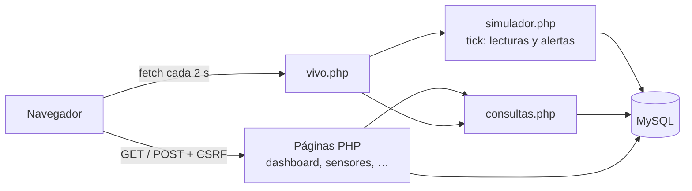
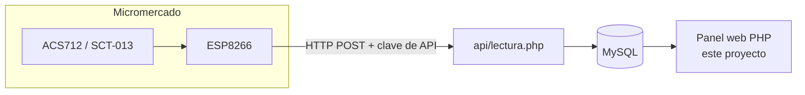

# Arquitectura

## Versión actual (PHP + MySQL, sensores virtuales)

Cada pantalla es un archivo PHP que valida la sesión y el rol, consulta MySQL con PDO y devuelve HTML. El módulo `app/simulador.php` genera una lectura por equipo cada 2 s y la guarda en la tabla `lecturas`; las alertas se abren y cierran en la tabla `alertas`.

### Módulos

| Archivo | Responsabilidad |
|---|---|
| `config/config.php` | Constantes (voltaje, intervalo, zonas, roles) y definición de pantallas |
| `app/bootstrap.php` | Sesión segura, cabeceras HTTP de seguridad y manejo de errores |
| `app/db.php` | Conexión PDO y configuración local |
| `app/helpers.php` | Escape de HTML, formato, CSRF, avisos, CSV seguro |
| `app/auth.php` | Login (bcrypt), bloqueo por intentos y permisos por rol |
| `app/simulador.php` | Sensores virtuales: genera lecturas y crea/cierra alertas |
| `app/consultas.php` | Energía (kWh), series y últimas lecturas calculadas en SQL |
| `app/layout.php` | Cabecera, menú y pie comunes |
| `app/vistas/*.php` | Fragmentos en vivo (dashboard, monitoreo, alertas) |
| `vivo.php` | Toma una lectura y devuelve el HTML de la parte dinámica en JSON |
| `js/app.js`, `js/graficos.js` | Refresco en vivo, avisos y gráficas en canvas |

### Cálculos

- Corriente: `I = P / V`, con `V = 220 V`.
- Energía: integral de la potencia por la regla del trapecio con las marcas de tiempo reales, calculada en SQL con `LAG()`: `kWh = Σ ((P₍ᵢ₋₁₎ + Pᵢ) / 2) · Δt / 3 600 000` (Δt en ms). Los intervalos de más de 10 s (sensor sin datos) no se integran.
- Costo: `kWh × tarifa (Bs/kWh)`.
- Alerta: se abre cuando `P > umbral` y se cierra sola cuando `P ≤ umbral`. Una alerta ya atendida no vuelve a abrirse mientras siga sobre el umbral.

### Base de datos

Tablas: `usuarios`, `zonas`, `equipos`, `lecturas`, `alertas`, `reportes` e `intentos_login`. Ver [`../database/schema.sql`](../database/schema.sql).

## Arquitectura objetivo (con hardware real)

Para llegar a esta versión se agrega un endpoint que inserte en `lecturas` y se deja de llamar a `tick()` en `vivo.php` y en las páginas; el resto de la aplicación no cambia.
